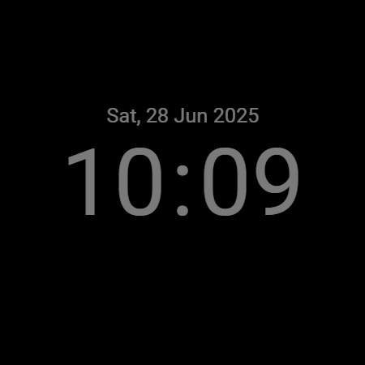
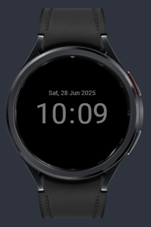
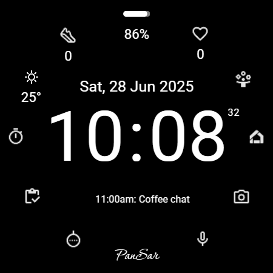
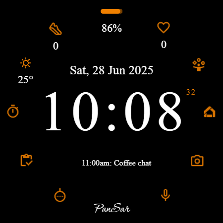
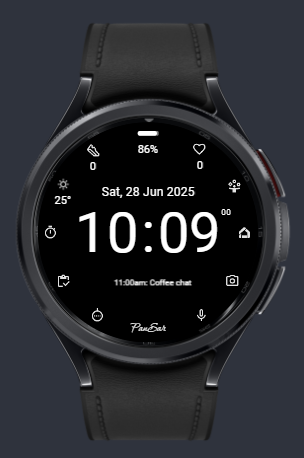
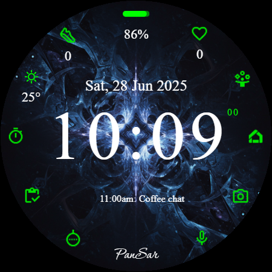
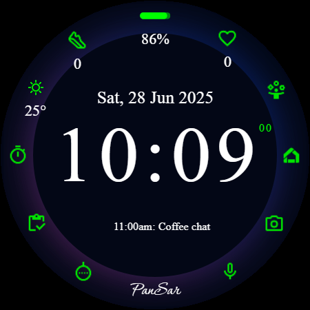
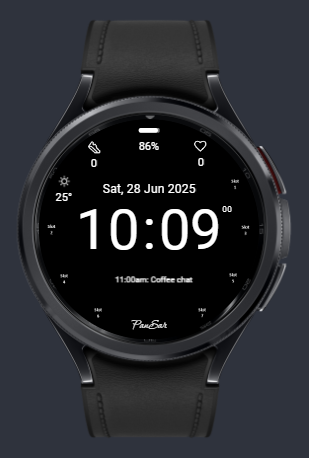

# Watch Face Total View

A comprehensive watch face designed for Wear OS, created using **Watch Face Studio**. this project aims to provide a total view of essential information at a glance, combining functionality with a modern aesthetic.

## Features

- **Total Information:** Displays clear and concise data including battery, steps, heart rate, and more.
- **Customizable:** Built with Watch Face Studio for flexibility and customization.
- **Modern Design:** Features a clean and modern aesthetic suitable for daily wear.

## Gallery

Here are some screenshots of the watch face demonstrating different states and customizations:

### Locked Screen (AOD)

  
    

### Theme Variations

  
  
  

### Background Variations

  
    

### Composition Variation

    

## Getting Started

To edit or build this watch face, follow these steps:

1. **Install Watch Face Studio:** Download and install [Watch Face Studio](https://developer.samsung.com/watch-face-studio/download.html) from the Samsung Developer website.
2. **Clone the Repository:** Clone this repository to your local machine.
3. **Open Project:**
   - Launch Watch Face Studio.
   - Click on **Open Project**.
   - Navigate to the `src` directory of this repository.
   - Select one of the `.wfs` files (e.g., `src/Watchface Total View 5.wfs` for the latest version).
4. **Run on Device:** Connect your Wear OS watch or emulator and click the **Run on Device** button to deploy and test.

## Project Structure

- `src/`: Contains the Watch Face Studio project files (`.wfs`).
- `assets/`: Screenshots and preview images used in this README.
- `background_images/`: Custom background assets used in the design.
- `fonts/`: Custom fonts used in the watch face.
- `icons/`: Icon assets.

## Contributing

Contributions are welcome! If you have suggestions for improvements or new features, please open an issue or submit a pull request.

## License

This project is licensed under the MIT License - see the LICENSE file for details.
